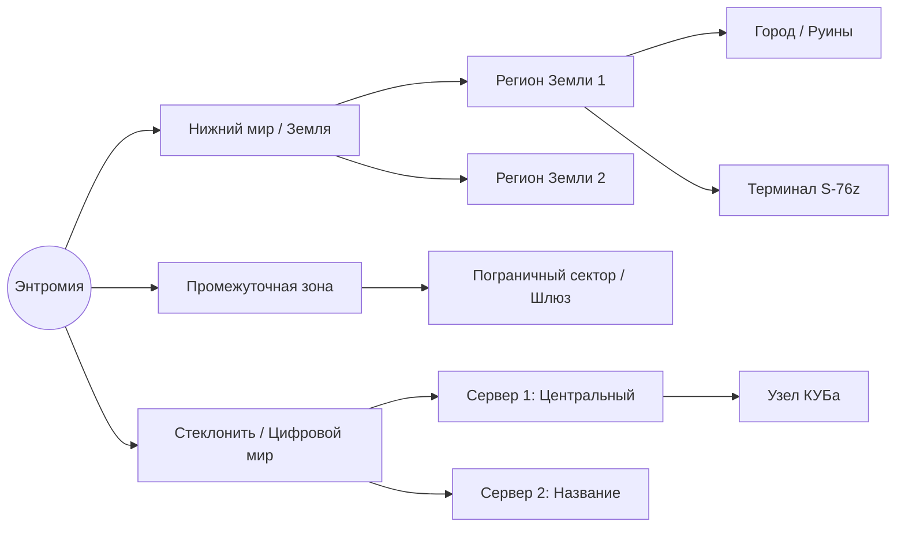

# География Энтромии

## Атлас Энтромии (список для быстрого перехода)

### 1. [[Нижний Мир]] (Земля)
* **[[Регион Земли 1]]** — краткое описание (климат, состояние руин).
  * Локации: 
  * Активные фракции: 
* **[[Регион Земли 2]]** — краткое описание.

### 2. Промежуточные регионы (Пограничье)
* **[[Пограничный сектор / Шлюз]]** — место стыка материи и кода.
  * Активные фракции: [[ ]]

### 3. Стеклонить (Сервера)
* **[[Сервер 1: Центральный]]** — архитектура и правила сервера.
  * Локации: [[Узел КУБа]]
  * Активные фракции: [[Корпорация Устранения Багов]]
* **[[Сервер 2: Название]]** — краткое описание.
